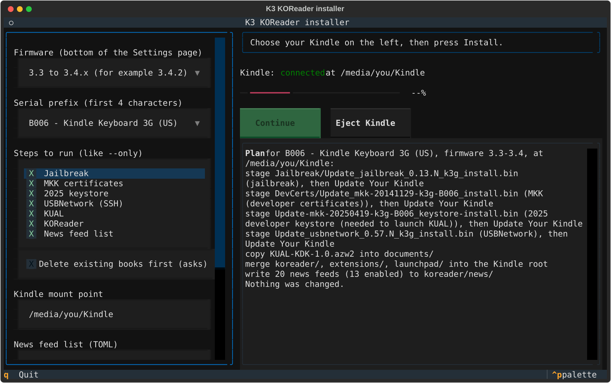

# koreader_D00901

Install [KOReader](https://github.com/koreader/koreader) on the Amazon Kindle Keyboard (K3, model
D00901) from Linux, repeatably, across any number of units.

**Use this at your own risk:** it modifies your Kindle's firmware, and I am not responsible for a
unit that stops working.



## Quickstart

1. Charge the Kindle, deregister it, and turn wireless off.
2. Note the firmware version (bottom of the Settings page) and the serial prefix (B006, B008 or B00A).
3. Connect the Kindle in USB drive mode, then run:

```
uv tool install koreader_D00901    # or: pipx install koreader_D00901
koreader-d00901-tui
```

4. Pick the firmware and model, press **Install**, and follow the on-screen steps. At each update
   it tells you to eject, apply Settings > Update Your Kindle on the device, and plug back in.
5. When it's done, open **KUAL** from the Kindle's library and choose **KOReader > Start KOReader**.

## Features

- Applies the whole chain in order: jailbreak, MKK developer certificates, the 2025 developer
  keystore (without it, current KUAL fails with "not signed by a registered developer"), optional
  USBNetwork, KUAL and KOReader.
- Picks the right files for your serial prefix and firmware range.
- Pins every upstream package by sha256, and never executes anything it downloads on your computer.
- Two front ends: a full-screen TUI (`koreader-d00901-tui`) and a terminal script (`koreader-d00901`)
  with a dry run, `--only STEP` and more.
- Can delete the books already on a second-hand unit first, after showing you exactly what will go.
- Sets up KOReader's news downloader with a short, curated list of security, engineering and
  research feeds, which each Kindle fetches itself over Wi-Fi.
- Optionally turns a K3 on its charger into an e-ink Grafana status display.
- `koreader-d00901-battery` reads and logs each unit's battery over USBNetwork, to track health and drain.

## Documentation

- [Installing](https://github.com/sethbarrett50/koreader_D00901/blob/main/docs/install.md): preparation, every flag, the on-device steps, troubleshooting, pinned packages, credits
- [USBNetwork](https://github.com/sethbarrett50/koreader_D00901/blob/main/docs/usbnetwork.md): SSH into a K3 over USB
- [News feeds](https://github.com/sethbarrett50/koreader_D00901/blob/main/docs/rss.md): the feed list, syncing on the Kindle, changing the list
- [Status display](https://github.com/sethbarrett50/koreader_D00901/blob/main/docs/dashboard.md): a Grafana dashboard on a K3's screen
- [Battery](https://github.com/sethbarrett50/koreader_D00901/blob/main/docs/battery.md): health and drain measurements per unit
- [Development](https://github.com/sethbarrett50/koreader_D00901/blob/main/docs/development.md): make targets, code layout, CI, releasing
- [Changelog](https://github.com/sethbarrett50/koreader_D00901/blob/main/CHANGELOG.md)

## Credits

This tool only automates the work of others: NiLuJe's jailbreak, MKK and KUAL packages on
[MobileRead](https://www.mobileread.com/forums/showthread.php?t=225030), and the
[KOReader](https://github.com/koreader/koreader) project. MIT licensed.
