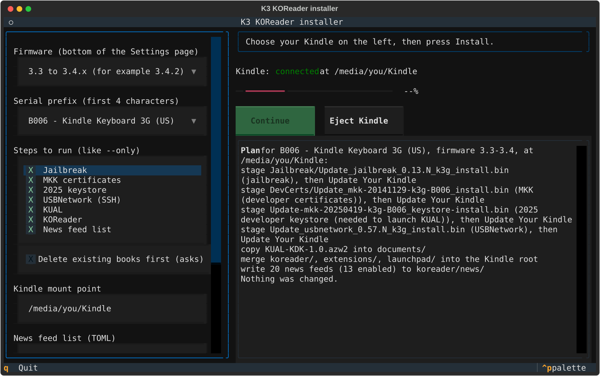

# Installing KOReader on a Kindle Keyboard (K3)

Use this at your own risk: it modifies your Kindle's firmware.

## What gets installed

The installer downloads pinned, checksum-verified packages and stages them on a K3 mounted as a USB
drive, in this order:

1. **Jailbreak**, which lets the Kindle install custom update packages.
2. **MKK**, the developer certificates the Kindle needs to run custom Kindlets such as KUAL.
3. **2025 developer keystore.** MKK's 2014 certificates expired in April 2025, and current KUAL is
   signed with NiLuJe's 2025 certificates. This update adds them. Without it, KUAL fails with
   "not signed by a registered developer".
4. **USBNetwork** (optional, `--usbnet`), for SSH over USB. See [usbnetwork.md](usbnetwork.md).
5. **KUAL** (the Kindle Unified Application Launcher), copied into `documents/`.
6. **KOReader**, merged into the Kindle's root.
7. **News feeds**, the feed list for KOReader's news downloader (`koreader/news/feed_config.lua`).
   See [rss.md](rss.md).

Steps 1 to 4 are update packages that you apply on the Kindle one at a time. Steps 5 to 7 are file
copies. Optionally, the installer first deletes the books already on the unit (`--wipe-books`).

## Before you start

- Charge the Kindle fully.
- Deregister it: Settings > Registration > Deregister.
- Turn wireless off.
- Find your firmware version at the bottom of the Settings page (for example 3.4.2).
- Find your serial prefix: the first four characters of the serial number (B006, B008 or B00A),
  listed under Device Info or on the back of the unit.

## Which files your Kindle needs

The installer picks the right files from your serial prefix and firmware range.

| Serial prefix | Model                        | Variant |
| ------------- | ---------------------------- | ------- |
| B006          | Kindle Keyboard 3G (US)      | k3g     |
| B008          | Kindle Keyboard Wi-Fi        | k3w     |
| B00A          | Kindle Keyboard 3G (UK/EU)   | k3gb    |

Firmware 3.0-3.2 uses the jailbreak file marked `-3.0-to-3.2`. Firmware 3.3-3.4 uses the plain
jailbreak file. The installer asks for the range as `3.0-3.2` or `3.3-3.4`.

## Getting the installer

```
uv tool install koreader_D00901    # or: pipx install koreader_D00901
```

To run it once without installing it, use `uvx --from koreader_D00901 koreader-d00901-tui`. From a
clone of the repo, use `uv run koreader-d00901-tui` (or `uv run koreader-d00901`).

## The full-screen installer (recommended)

Connect the Kindle in USB drive mode and run `koreader-d00901-tui`.



1. Pick the firmware range and model. The mount point is detected automatically, or you can type it.
2. The **Steps** list has every step ticked except USBNetwork. Tick **USBNetwork** to add it, or
   untick steps a unit already has (the same as `--only`). Optionally tick **Delete existing books
   first**: it shows the full list of what will be deleted and asks before anything is removed.
3. **News feed list** is blank for the bundled list (see [rss.md](rss.md)), or a path to your own
   TOML. **Show debug log** adds debug lines to the log panel (the same as `--verbose`).
4. **Dry run** shows the plan and changes nothing (the same as `--dry-run`). **Install** starts.
5. At each update step the installer stages one file and shows what to do on the Kindle. Press
   **Eject Kindle**, unplug, and apply the update on the device (see below). When it has rebooted,
   plug it back in and press **Continue**. Continue waits until the Kindle is mounted again.
6. After the last copy, press **Eject Kindle** and open KOReader (see below).

## The terminal installer

The same install runs as a plain script that prompts and waits for Enter between updates. Do a dry
run first: it prints the plan and changes nothing.

```
koreader-d00901 --dry-run
koreader-d00901
```

Flags (the TUI takes the same ones to preselect its choices, except where noted):

- `--dry-run` (CLI only; the TUI has a **Dry run** button): print the plan only.
- `--mount PATH`: the Kindle's USB mount point. Without it the installer looks for a volume labelled Kindle.
- `--fw RANGE`: firmware range, `3.0-3.2` or `3.3-3.4`. Asked interactively if omitted.
- `--prefix PREFIX`: serial prefix, `B006`, `B008` or `B00A`. Asked interactively if omitted.
- `--usbnet`: also install USBNetwork.
- `--wipe-books`: delete the existing books in `documents/` first, which is handy for second-hand
  units. It lists everything it will delete and asks you to type `wipe` (the TUI shows a dialog).
  It keeps `KUAL-KDK-1.0.azw2` and the `dictionaries` folder, and never touches anything outside
  `documents/`. With `--dry-run` it only lists what it would delete.
- `--only STEP` (repeatable): run just these steps. STEP is `jailbreak`, `mkk`, `keystore`,
  `usbnet`, `kual`, `koreader` or `feeds`. For example, `--only usbnet` adds USBNetwork to a unit
  that is already set up, and `--only feeds` updates just the news feed list. In the TUI it
  preselects the **Steps** list.
- `--feeds FILE`: the news feed list to write to the Kindle (default: the bundled list). See
  [rss.md](rss.md).
- `--cache DIR`: where downloads are kept (default `~/.cache/k3-koreader`).
- `--log-file FILE`: where the debug log goes (default `CACHE/install.log`).
- `-v`, `--verbose`: also print debug logging on the terminal (in the TUI, it ticks **Show debug log**).
- `--version`: print the version.

Every download is checked against the sha256 pinned in the package and rejected if it does not
match. Every run writes a debug log. If an install fails, check
`~/.cache/k3-koreader/install.log` first.

## On the Kindle

For each update package the installer stages one `.bin` file and pauses. Then:

1. Eject and unplug the Kindle (safely eject it first; the update cannot run in USB drive mode).
2. Press [HOME] > [MENU] > Settings > [MENU] > Update Your Kindle.
3. Wait for the reboot, reconnect in USB drive mode, and press Continue (TUI) or Enter (CLI).

The order is jailbreak, then MKK, then the 2025 keystore (then USBNetwork if requested). After the
copies, eject the Kindle, open KUAL from the library and choose KOReader > Start KOReader.

KUAL's KOReader menu has these entries:

- **Start KOReader**: the normal mode. Use it.
- **Start KOReader (no framework)**: stops the Kindle's own reader software while KOReader runs,
  which frees memory on the K3's 256 MB. Leaving KOReader then takes longer. Try it if large PDFs
  are slow or crash.
- **Start KOReader ASAP** skips a short delay. It is meant for scripts.
- **Tools**: maintenance actions.

## If something goes wrong

- **Update Your Kindle is greyed out:** the wrong file was staged. Check your serial prefix and
  firmware range and run the installer again.
- **Never force an update** by rebooting the Kindle by hand.
- **The Kindle hangs:** hold the power button for about 15 seconds for a hard reboot.
- **The certificates disappeared:** deregistering or an over-the-air (OTA) update can remove the
  developer certificates. Reinstall MKK and the keystore when that happens
  (`koreader-d00901 --only mkk --only keystore`).
- **KUAL says the title is "not signed by a registered developer":** the 2025 keystore update did
  not apply. Run `koreader-d00901 --only keystore` and apply the update again.
- **For on-device problems,** type `;dumpMessages` in the Kindle's search bar. It writes
  `documents/all_logs_as_of_*.txt`, which you can attach to a bug report.

## Pinned packages

| Package    | File                                     | sha256 (first 12) |
| ---------- | ---------------------------------------- | ----------------- |
| jailbreak  | kindle-jailbreak-0.13.N-r18833.tar.xz    | 8f5c8a78e3c4      |
| mkk        | kindle-mkk-20141129-r18833.tar.xz        | 3d7289f1ddcf      |
| keystore   | DevCerts-20250419-KeyStore.zip           | 48426add32e3      |
| kual       | KUAL-v2.7.37-gfcb45b5-20250419.tar.xz    | 40c4b6871221      |
| usbnet     | kindle-usbnetwork-0.57.N-k3.zip          | 7d210bc41619      |
| koreader   | koreader-kindle-legacy-v2026.07.1.zip    | 0ed8d5eec422      |

A weekly CI job re-downloads each of these and checks it still matches (see
[development.md](development.md)).

## Credits

- Jailbreak: https://www.mobileread.com/forums/showthread.php?t=225030
- 2025 developer keystore (NiLuJe, 2025-04-19): https://www.mobileread.com/forums/attachment.php?attachmentid=215127&d=1745098511
- KUAL: https://www.mobileread.com/forums/showthread.php?t=203326
- USBNetwork: https://www.mobileread.com/forums/showthread.php?t=88004
- KOReader: https://github.com/koreader/koreader
